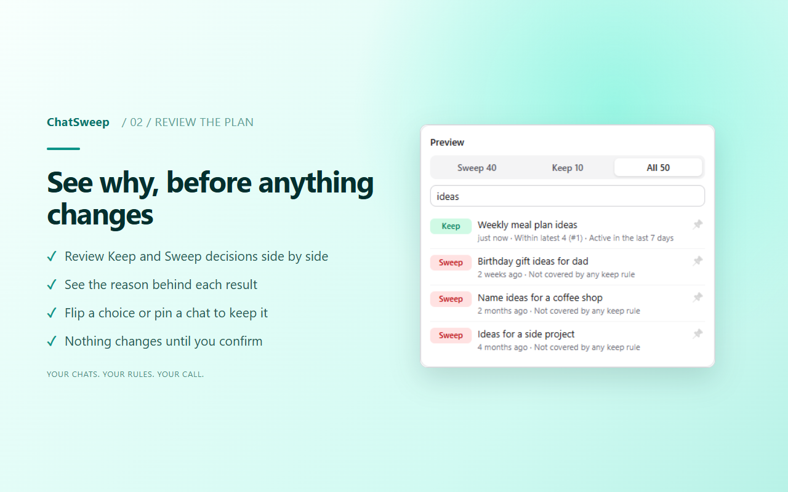

# 🧹 ChatSweep

[](https://github.com/Yousef-Diab/ChatSweep/actions/workflows/ci.yml)
[](LICENSE)

**Rule-based cleanup for your AI chat history.** Keep the chats that matter, and archive or delete the rest in one pass.

Works with **ChatGPT** (chatgpt.com) and **Claude** (claude.ai), in Chrome, Edge, Brave, Arc and Firefox. Both are verified on live accounts. More providers may follow.



Most bulk-delete tools have you tick checkboxes one chat at a time. ChatSweep instead applies a **retention policy**:

> Keep my latest 30 chats, anything active this week, anything with "invoice" or "passport" in the title, chats in Projects, and anything I've pinned. Archive everything else.

Before anything changes, you see a **preview** that lists, for every chat, **why** it will be kept or swept.

## Features (v0.3)

- **Keep rules:** keep the latest N chats, keep chats active in the last X days, protect titles (plain text or `/regex/`), protect Project chats, custom-GPT chats and pinned chats, and pin individual chats inside ChatSweep.
- **Preview with reasons**, for example `Within latest 30 (#12)`, `Title matches "invoice"`, `Inside a project`, `Not covered by any keep rule`.
- **Manual overrides:** click a row to flip Keep/Sweep. Protections always win; to sweep a protected chat, change the rule or unpin it.
- **Safe by default:** the default action is **Archive** (reversible in ChatGPT → Settings → Data controls → Archived chats). **Delete** asks you to type the number of chats to confirm.
- **Polite and resumable:** requests run one at a time with a delay between them, and the delay grows automatically when the provider rate-limits. Pause, resume, cancel and retry-failed are all available. Progress is saved after every chat, so a browser restart doesn't lose your place.
- **Presets:** three built-ins (Gentle, Balanced, Fresh start), plus your own saved rule sets. Applying a preset keeps your pinned chats.
- **Backup before sweeping:** a zip with a readable Markdown copy and the raw JSON of every chat that will be swept. It's on by default for deletes and optional for archives. If any chat fails to back up, nothing is swept.
- **Scheduled checks (queue, notify, confirm):** you can have ChatSweep re-check every 1, 7, 14 or 30 days, or click "Check now". A check only counts what your rules would sweep, shows the number on the toolbar icon, and waits. **It never sweeps on its own.**
- **ChatGPT and Claude:** switch between them at the top of the panel; each has its own rules, presets and schedule.
- **Private:** no server, no analytics, no tracking. On first open, ChatSweep explains what it reads and stores and waits for you to agree. Your chat list and settings stay in `chrome.storage.local` on your machine.

## Install (from source)

```bash
npm install
npm run build
```

Then open `chrome://extensions`, enable **Developer mode**, click **Load unpacked** and select `.output/chrome-mv3`.
Open chatgpt.com or claude.ai (logged in) and click the ChatSweep toolbar icon to open the side panel. Use the
ChatGPT / Claude switcher at the top of the panel; each provider has its own rules, presets, schedule and cache.

Supported browsers: Chrome, Edge, Brave and Arc.

**Firefox (142+):** run `npm run build:firefox`, then open `about:debugging` → This Firefox → **Load Temporary Add-on**
and pick `.output/firefox-mv3/manifest.json`. ChatSweep opens in the sidebar; the toolbar button toggles it. Temporary add-ons are removed when Firefox closes;
a permanent install will come from addons.mozilla.org.

## How it works

ChatSweep has no public API to talk to, because neither ChatGPT nor Claude offers one for managing chats. A small content script on each site
calls the same internal endpoints that site's web app uses, with **your existing logged-in session**.

**ChatGPT:**

| What | Endpoint |
|---|---|
| Session | `GET /api/auth/session` |
| List chats | `GET /backend-api/conversations?offset&limit&order=updated&is_archived=false` |
| Archive | `PATCH /backend-api/conversation/{id}` `{"is_archived": true}` |
| Delete | `PATCH /backend-api/conversation/{id}` `{"is_visible": false}` |
| Backup | `GET /backend-api/conversation/{id}` |

The access token lives only in the content script's memory. It is never stored, logged or sent anywhere else.

**Claude** (session cookie only, no token):

| What | Endpoint |
|---|---|
| Account / org | `GET /api/organizations` (uses the org you last used on claude.ai if it can chat, otherwise the first one that can) |
| List chats | `GET /api/organizations/{org}/chat_conversations?limit&offset` |
| Delete | `DELETE /api/organizations/{org}/chat_conversations/{uuid}` (one at a time) |
| Backup | `GET /api/organizations/{org}/chat_conversations/{uuid}?tree=True&rendering_mode=messages` |

Claude has no archive, so the only action there is **Delete**, with the backup on by default and a typed confirmation.
Starred chats and chats in Projects are protected by default, the same as pinned and Project chats on ChatGPT.

Verified live: the read endpoints and a delete with backup.

> ⚠️ These endpoints are **unofficial** and can change without notice. If ChatGPT changes them, ChatSweep stops working
> and shows an error; it does not guess. "Delete" hides the chat from your account the same way ChatGPT's own delete
> button does. What OpenAI retains server-side is governed by their policies, not by this tool.

ChatSweep only automates actions you could take yourself in the ChatGPT or Claude UI, on your own account.

## Permissions

| Permission | Why |
|---|---|
| `storage` | Saving your rules, the cached chat list and the progress of a running sweep, on this device only |
| `sidePanel` | The ChatSweep UI |
| `alarms` | Waking up for scheduled checks (which only count; they never sweep) |
| `https://chatgpt.com/*` | Running the content script that talks to ChatGPT with your session |
| `https://claude.ai/*` | Running the content script that talks to Claude with your session |

There is no `<all_urls>`, no `tabs` permission, no remote code and no analytics.

## Development

```bash
npm run dev        # WXT dev mode with hot reload (opens a browser with the extension loaded)
npm test           # unit tests (Vitest): rules engine, ChatGPT + Claude adapters, job runner/controller
npm run e2e        # builds, then runs the extension in real Chromium against mocked chatgpt.com and claude.ai
npm run compile    # type-check
npm run lint:firefox  # Firefox build + Mozilla's web-ext lint
npm run zip && npm run zip:firefox   # store packages in .output/
npm run icons      # regenerate public/icon/*.png
npm run store:assets  # renders store screenshots + promo tile into store/ (git-ignored)
```

Project layout:

```
entrypoints/   background.ts (job controller) · chatgpt.content.ts · claude.content.ts · sidepanel/ (React UI)
src/core/      rules + planner: pure functions, the heart of the app
src/providers/ provider adapters (ChatGPT, Claude) + registry
src/jobs/      job runner (throttle, backoff, resume) + controller + scheduled checks
src/backup/    Markdown rendering + zip packaging for pre-sweep backups
src/ui/        React components
tests/         unit tests + fixtures
e2e/           Playwright end-to-end tests (ChatGPT, Claude, probes)
spike/         read-only probes for checking the live ChatGPT and Claude APIs
```

### Checking the live API

`spike/chatgpt-probe.js` is a **read-only** script you paste into DevTools on chatgpt.com. It prints a redacted report
of the real response shapes (field names and types, page size, whether Project chats show up in the main list).
Run it whenever ChatSweep breaks, or before a release. `spike/claude-probe.js` does the same on claude.ai.

Contributors: start with [CONTRIBUTING.md](CONTRIBUTING.md).

## Roadmap

- Chrome Web Store and Firefox Add-ons listings
- More providers (Gemini, Perplexity, …)
- Smarter rules, e.g. sweep one-message or untitled "New chat" sessions

## Contributing

Bug reports, rule ideas and PRs are welcome: see [CONTRIBUTING.md](CONTRIBUTING.md). Security issues: [SECURITY.md](SECURITY.md).

ChatSweep is an independent project, not affiliated with OpenAI or Anthropic.

## License

MIT
